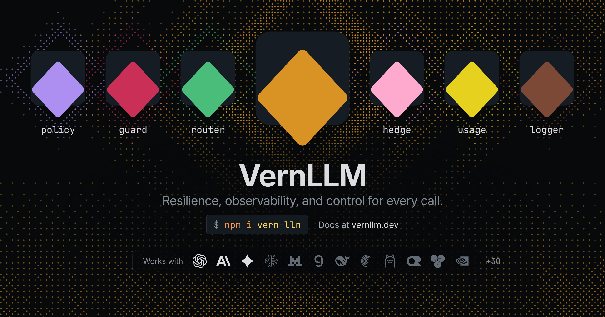

<p align="center">
  
</p>

<h1 align="center">VernLLM</h1>

<p align="center">
  <a href="https://vernllm.dev">Documentation</a> ·
  <a href="./packages/vern-llm">Package</a> ·
  <a href="https://npmjs.com/package/vern-llm">npm</a>
</p>

<p align="center">
  <a href="https://www.npmjs.com/package/vern-llm"></a>
  <a href="https://www.npmjs.com/package/vern-llm"></a>
  <a href="https://github.com/LakBud/vernLLM/actions/workflows/ci.yml"></a>
  <a href="https://codecov.io/gh/LakBud/vernLLM"></a>
  <a href="https://www.bestpractices.dev/projects/14212"></a>
  <a href="./LICENSE.md"></a>
  <a href="https://x.com/VernLLM"></a>
</p>

<p align="center">The LLM call framework. Resilience, observability, and control for every call.</p>

<p align="center">One interface across OpenAI-compatible, Anthropic, Gemini, and Bedrock, with retry budgets, circuit breaking, multi provider fallback, rate limiting, caching, and middleware built in, all running in your own process rather than a new network hop.</p>

```ts
import Anthropic from '@anthropic-ai/sdk';
import OpenAI from 'openai';
import { VernLLM } from 'vern-llm';
import { fromAnthropic, fromOpenAI } from 'vern-llm/adapters';

const openai = fromOpenAI(new OpenAI({ apiKey: process.env.OPENAI_API_KEY }));
const anthropic = fromAnthropic(new Anthropic({ apiKey: process.env.ANTHROPIC_API_KEY }));

const llm = new VernLLM({
  client: openai,
  model: 'gpt-6-sol',
  fallback: { client: anthropic, model: 'claude-opus-5-5', circuitBreaker: true },
  rateLimit: { requestsPerMinute: 500, tokensPerMinute: 100_000, maxConcurrent: 20 },
  retryBudget: { windowMs: 60_000, minCalls: 20, retryRatio: 0.2 },
  maxRetries: 3,
  timeoutMs: 10_000,
  defaultMaxTokens: 1000,
  defaultReasoningEffort: 'medium',
});

const result = await llm.call({ userContent: "What's the weather in New York?" });
```

## Extensions

Optional packages that add a capability inside VernLLM, with no third party dependency. Each one is a [middleware](https://vernllm.dev/docs/core/middleware) that depends only on `vern-llm`, so you install only what you use.

| Package                                                    | What it adds                                                                                |
| ---------------------------------------------------------- | ------------------------------------------------------------------------------------------- |
| [`vern-llm-logger`](./packages/extensions/vern-llm-logger) | One structured record per call, rolling latency percentiles, slow call and error detection. |
| [`vern-llm-usage`](./packages/extensions/vern-llm-usage)   | Estimated cost and wasted spend per call, plus token and dollar budgets that reject early.  |
| [`vern-llm-router`](./packages/extensions/vern-llm-router) | Orders targets by rules, health, latency, or cost, with a dry run and shadow mode.          |
| [`vern-llm-policy`](./packages/extensions/vern-llm-policy) | Removes forbidden targets, fails safe, and audits every decision.                           |
| [`vern-llm-guard`](./packages/extensions/vern-llm-guard)   | Labels, redacts or blocks what goes into a call and what comes out, streams included.       |
| [`vern-llm-hedge`](./packages/extensions/vern-llm-hedge)   | Sends a slow call to the next target too and keeps the first answer.                        |

```ts
import { jsonSink, loggerMiddleware } from 'vern-llm-logger';
import { guardMiddleware, patterns } from 'vern-llm-guard';

const logger = loggerMiddleware({ sink: jsonSink() });
const guard = guardMiddleware({
  version: '2026-10-25.1',
  checks: [{ id: 'secrets', detect: patterns(['secrets']), action: 'block' }],
});

const llm = new VernLLM({ client: openai, model: 'gpt-6-sol', middleware: [logger, guard] });
```

Every extension has a fixed place in the call, so the order you list them in never matters. See the [extensions docs](https://vernllm.dev/docs/extensions) for how they compose.

## Integrations

Optional packages that connect VernLLM to what lives outside your process: state shared across instances, telemetry, and provider SDKs. Each one backs an extension point core already exposes, so your calls don't change, and takes `vern-llm` as a peer dependency. Start without any, and add one when your app runs as more than one process, you want calls in your observability stack, or your provider needs its own SDK.

| Package                                                        | What it connects                                                                                        |
| -------------------------------------------------------------- | ------------------------------------------------------------------------------------------------------- |
| [`vern-llm-redis`](./packages/integrations/vern-llm-redis)     | Shares circuit breaker, rate limit, retry budget, and cache state across every process running VernLLM. |
| [`vern-llm-otel`](./packages/integrations/vern-llm-otel)       | Turns every call into OpenTelemetry traces and metrics that follow the GenAI semantic conventions.      |
| [`vern-llm-bedrock`](./packages/integrations/vern-llm-bedrock) | Calls every AWS Bedrock Converse model through the AWS SDK's own client.                                |

```ts
import Redis from 'ioredis';
import { otelMiddleware } from 'vern-llm-otel';
import { redisCache, redisCircuitBreaker, redisRateLimit } from 'vern-llm-redis';
import { fromIoredis } from 'vern-llm-redis/clients';

const redis = fromIoredis(new Redis());

const llm = new VernLLM({
  client: openai,
  model: 'gpt-6-sol',
  circuitBreaker: redisCircuitBreaker(redis),
  rateLimit: redisRateLimit(redis, { requestsPerMinute: 500 }),
  cache: redisCache(redis),
  middleware: [otelMiddleware({ providerNames: { primary: 'openai' } })],
});
```

See the [integrations docs](https://vernllm.dev/docs/integrations) for setup and options.

## Adapters

VernLLM talks to every provider through one small `LLMClient` interface. An adapter translates a provider's native API into that shape, so retries, fallback, rate limiting, and caching behave the same whichever provider is behind a call.

The adapters live inside the core `vern-llm` package, on their own `vern-llm/adapters` entry so the main entry stays provider free:

| Adapter                                 | Providers                                                                                                                                                            |
| --------------------------------------- | -------------------------------------------------------------------------------------------------------------------------------------------------------------------- |
| `fromOpenAI` and `fromOpenAICompatible` | OpenAI, plus named aliases for Groq, Mistral, DeepSeek, Cerebras, Together AI, Fireworks AI, Ollama, OpenRouter, xAI, vLLM, LM Studio, and any OpenAI compatible API |
| `fromAnthropic`                         | Anthropic                                                                                                                                                            |
| `fromGemini`                            | Gemini                                                                                                                                                               |
| `fromFetch`                             | Any provider reachable over HTTP, with your own URL, headers, and request and response mapping                                                                       |

```ts
import { fromAnthropic, fromGroq, fromOpenAI } from 'vern-llm/adapters';
```

AWS Bedrock is the one provider that isn't in core. It ships as an [integration](#integrations), `fromBedrock` in `vern-llm-bedrock`, because it is built on the AWS SDK client. See the [adapters docs](https://vernllm.dev/docs/adapters) for every named provider.

## Better together

Every package stands alone, so you can mix extensions, integrations, and adapters freely. Some combinations are worth reaching for, and these are a few examples:

- **Privacy by routing (guard, policy, Bedrock):** the guard finds PII, with the built in detectors or your AWS Bedrock guardrails through `bedrockGuardrail`, and policy removes every target that keeps data or sits in the wrong region. If the guard didn't run, policy treats the call as sensitive, so it fails closed.
- **Faster tails without a bigger bill (hedge, usage):** hedge sends a slow call to a second target and keeps the first answer. Usage lets you skip targets that cost far more or stop hedging when a budget is nearly spent, and policy flags can keep sensitive calls from being sent twice.
- **Routing that tunes itself (router, logger):** the router ranks targets by measured latency, failure rate, and cost, so a provider that slows down or starts returning unusable answers loses first place. Shadow mode lets you check its picks before switching it on.
- **A budget per tenant for the whole fleet (usage, Redis):** limits such as $50 a day per tenant are checked before a provider is contacted, and `redisUsageStore` shares them across every process.
- **Traces that explain themselves (OpenTelemetry, router):** extension events such as `router.decision` become span events, so a trace can show why a call went where it did, not only that it did.

## Repository layout

This is a pnpm monorepo with multiple workspaces, managed with [Nx](https://nx.dev) for task caching and affected-based CI:

| Path                                                                                 | Description                                                                                                       |
| ------------------------------------------------------------------------------------ | ----------------------------------------------------------------------------------------------------------------- |
| [`packages/vern-llm`](./packages/vern-llm)                                           | The `vern-llm` npm package: source, tests, and its own README with the full API reference.                        |
| [`packages/integrations/vern-llm-redis`](./packages/integrations/vern-llm-redis)     | The `vern-llm-redis` npm package: Redis backed circuit breaker, rate limiter, and cache adapters for `vern-llm`.  |
| [`packages/integrations/vern-llm-otel`](./packages/integrations/vern-llm-otel)       | The `vern-llm-otel` npm package: OpenTelemetry traces and metrics for `vern-llm`.                                 |
| [`packages/integrations/vern-llm-bedrock`](./packages/integrations/vern-llm-bedrock) | The `vern-llm-bedrock` npm package: the AWS Bedrock Converse adapter for `vern-llm`, built on the AWS SDK client. |
| [`packages/extensions/vern-llm-logger`](./packages/extensions/vern-llm-logger)       | The `vern-llm-logger` package: structured call logs and rolling latency percentiles.                              |
| [`packages/extensions/vern-llm-usage`](./packages/extensions/vern-llm-usage)         | The `vern-llm-usage` package: estimated cost, wasted spend and budgets for each call.                             |
| [`packages/extensions/vern-llm-router`](./packages/extensions/vern-llm-router)       | The `vern-llm-router` package: picks the target order for each call from rules you write.                         |
| [`packages/extensions/vern-llm-policy`](./packages/extensions/vern-llm-policy)       | The `vern-llm-policy` package: rules for which providers and models a call may use, and whether it may run.       |
| [`packages/extensions/vern-llm-guard`](./packages/extensions/vern-llm-guard)         | The `vern-llm-guard` package: checks on what goes into a call and what comes out: label, redact or block.         |
| [`packages/extensions/vern-llm-hedge`](./packages/extensions/vern-llm-hedge)         | The `vern-llm-hedge` package: sends a slow call to the next target too and keeps the first answer.                |
| [`apps/docs`](./apps/docs)                                                           | The [Fumadocs](https://fumadocs.dev)-powered documentation site.                                                  |

## License

[MIT](./LICENSE.md) © LakBud
