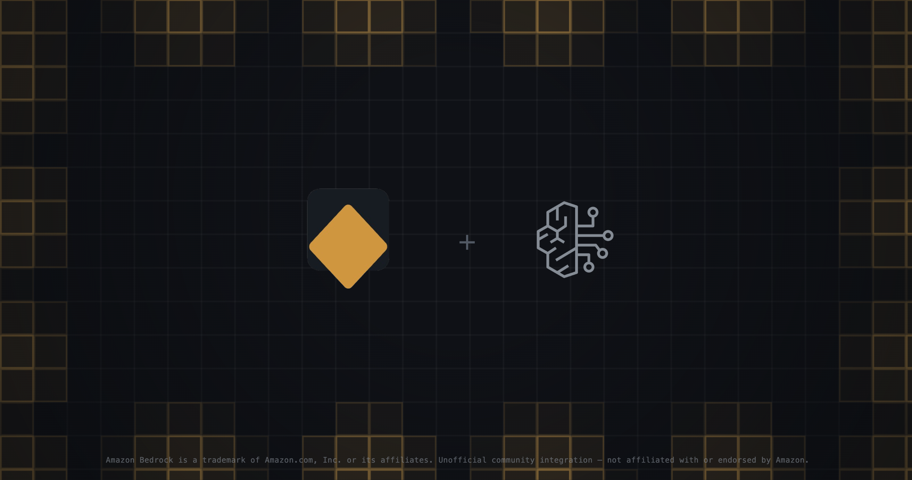

<p align="center">
  
</p>

<p align="center">
  <a href="https://vernllm.dev/docs/integrations/bedrock">Documentation</a> ·
  <a href="https://github.com/LakBud/vernLLM/tree/main/packages/integrations/vern-llm-bedrock">Package</a> ·
  <a href="https://www.npmjs.com/package/vern-llm-bedrock">npm</a>
</p>

<h1 align="center">vern-llm-bedrock</h1>

<p align="center">An AWS Bedrock Converse adapter for <a href="https://github.com/LakBud/vernLLM/tree/main/packages/vern-llm">vern-llm</a>, built on the AWS SDK's <code>BedrockRuntimeClient</code>. Every model Converse supports gets retries, timeouts, fallback, rate limiting and circuit breaking from vern-llm.</p>

<p align="center"><sub>Amazon Bedrock is a trademark of Amazon.com, Inc. This is an unofficial community integration, not affiliated with or endorsed by Amazon Web Services.</sub></p>

The AWS SDK retries on its own and can raise an exception in the middle of a stream that already started. Left alone, neither reaches your circuit breaker, rate limiter, or events. `vern-llm-bedrock` adapts the SDK's `BedrockRuntimeClient` to vern-llm through the Converse API, so every model Converse supports (Anthropic, Titan, Llama, Mistral, and others) gets the same retries, timeouts, fallback, rate limiting, and circuit breaking as any other provider.

It is a separate package because it is built on the AWS SDK client, which keeps core free of dependencies.

## Installation

```bash
npm i vern-llm-bedrock @aws-sdk/client-bedrock-runtime
```

`vern-llm` and `@aws-sdk/client-bedrock-runtime` are peer dependencies, so this package shares the copies your app already uses.

## Quick start

```ts
import { BedrockRuntimeClient } from '@aws-sdk/client-bedrock-runtime';
import { VernLLM } from 'vern-llm';
import { fromBedrock } from 'vern-llm-bedrock';

const llm = new VernLLM({
  client: fromBedrock(new BedrockRuntimeClient({ region: 'us-east-1', maxAttempts: 1 })),
  model: 'anthropic.claude-sonnet-4-5-20250929-v1:0',
});

const text = await llm.call({ userContent: 'Say hello.', jsonMode: false });
```

Pass `maxAttempts: 1` so vern-llm's retries are the only ones. If the SDK would still retry on its own, `fromBedrock` logs a warning once per process, since those retries are hidden from the breaker, the rate limiter, and your events.

## What you get

| Feature           | Behavior                                                                                                                           |
| ----------------- | ---------------------------------------------------------------------------------------------------------------------------------- |
| Structured output | `jsonSchema` as native `outputConfig.textFormat` on models you list, else a forced tool call                                       |
| Tools             | `tools` and `toolChoice` map to Converse `toolConfig`. `toolChoice: 'none'` with tools throws, since Converse has no equivalent    |
| Reasoning         | `reasoningEffort` and `budgetTokens` reach Claude models, with reasoning kept in history for tool loops                            |
| Streaming         | `ConverseStreamCommand` events become vern-llm chunks, and in-band stream exceptions become `LLMError`s the retry loop understands |
| Telemetry         | The adapter names itself `bedrock` with provider `aws.bedrock`, so middleware such as `vern-llm-otel` reports the right provider   |

## Usage

### Bedrock as a fallback

Because it is one more `LLMClient`, Bedrock can sit behind or in front of any other provider:

```ts
const llm = new VernLLM({
  client: fromOpenAI(openai),
  model: 'gpt-6-sol',
  fallback: {
    name: 'bedrock',
    client: fromBedrock(bedrock),
    model: 'anthropic.claude-sonnet-4-5-20250929-v1:0',
    circuitBreaker: true,
  },
});
```

### Guardrails

`vern-llm-bedrock/guardrail` adds `bedrockGuardrail`, a detector that runs text through an Amazon Bedrock guardrail with `ApplyGuardrail`. It finds topics, content filter hits, sensitive information, regex matches, and words, and leaves what to do about them to the caller, usually [`vern-llm-guard`](https://www.npmjs.com/package/vern-llm-guard).

```ts
import { BedrockRuntimeClient } from '@aws-sdk/client-bedrock-runtime';
import { bedrockGuardrail } from 'vern-llm-bedrock/guardrail';

const aws = bedrockGuardrail({
  client: new BedrockRuntimeClient({ region: 'eu-west-1' }),
  guardrailIdentifier: 'gr-abc123',
  guardrailVersion: '3',
});

const signal = AbortSignal.timeout(5000);
const found = await aws([{ text: 'Mail jane@acme.com', source: 'user' }], signal);
// [{ segment: 0, label: 'pii.EMAIL', start: 5, end: 18 }]
```

A finding is labeled `pii.<type>`, `regex.<name>`, `word.<type>`, `topic.<name>`, or `content.<type>`. Matches in sensitive information, regexes, and words become spans, so a redact check can mask them. `.only('pii', 'topic')` gives a detector for some kinds that shares requests and one cache with the rest. The text you check is sent to Bedrock, and a `DRAFT` version warns once and is never cached.

## Documentation

See the [Bedrock docs](https://vernllm.dev/docs/integrations/bedrock) for structured output, reasoning, streaming, tool calling, and [guardrails](https://vernllm.dev/docs/integrations/bedrock/guardrails).

## License

MIT
