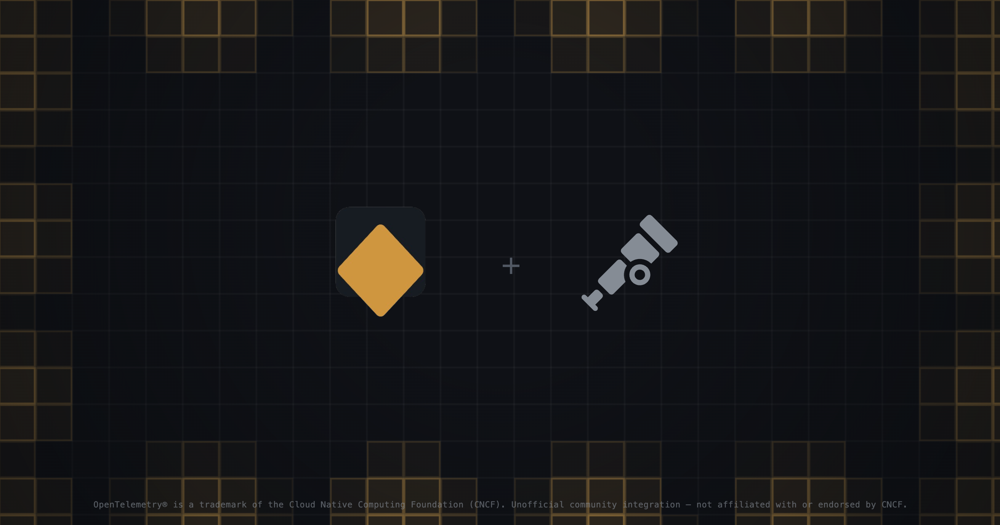

<p align="center">
  
</p>

<p align="center">
  <a href="https://vernllm.dev/docs/integrations/otel">Documentation</a> ·
  <a href="https://github.com/LakBud/vernLLM/tree/main/packages/integrations/vern-llm-otel">Package</a> ·
  <a href="https://www.npmjs.com/package/vern-llm-otel">npm</a>
</p>

<h1 align="center">vern-llm-otel</h1>

<p align="center">OpenTelemetry traces and metrics for <a href="https://github.com/LakBud/vernLLM/tree/main/packages/vern-llm">vern-llm</a>, following the GenAI semantic conventions. One middleware turns every call into spans and metrics, with retries, fallbacks, rate limit waits, and circuit breaker transitions visible.</p>

<p align="center"><sub>OpenTelemetry is a Cloud Native Computing Foundation project. This is an unofficial community integration, not affiliated with or endorsed by the CNCF or the OpenTelemetry project.</sub></p>

A span around an LLM call tells you it took 9 seconds. It doesn't tell you that 8 of them were a timeout on the primary, a rate limit wait, or a retry backoff. `vern-llm-otel` is one middleware that turns every vern-llm call into OpenTelemetry traces and metrics, with each attempt as its own span, so the trace shows why a call was slow and not only that it was.

## Installation

```bash
npm i vern-llm-otel @opentelemetry/api
```

`vern-llm` and `@opentelemetry/api` (1.9 or newer) are peer dependencies, so this package shares the copies your app already uses. It depends on no SDK: spans and metrics go wherever your own OpenTelemetry setup sends them.

## Quick start

Start your OpenTelemetry SDK as usual, then add the middleware:

```ts
import { VernLLM } from 'vern-llm';
import { otelMiddleware } from 'vern-llm-otel';

const llm = new VernLLM({
  client,
  model: 'gpt-4o',
  middleware: [otelMiddleware({ providerNames: { primary: 'openai' } })],
});
```

A call that timed out on its primary target and was answered by a fallback now looks like this:

```text
vernllm.call                 INTERNAL   one per call
├── chat gpt-4o              CLIENT     attempt 1, error.type = timeout
└── chat gpt-4o-mini         CLIENT     attempt 1 of fallback[0], ok
```

Spans nest under whatever span is active when the call starts, so your app's own request or agent span adopts them with no configuration.

## What you get

| Signal  | Emitted                                                                                                                 |
| ------- | ----------------------------------------------------------------------------------------------------------------------- |
| Traces  | A `vernllm.call` span per call and a `chat {model}` span per attempt, so every retry and fallback is its own child span |
| Metrics | `gen_ai.client.token.usage`, `gen_ai.client.operation.duration`, and `gen_ai.client.operation.time_to_first_chunk`      |
| Metrics | `vernllm.*` counters and histograms for retries, fallbacks, rate limit waits, and circuit transitions                   |
| Events  | Extension events such as `router.decision` become span events, so a trace shows why a call went where it did            |

## What makes the numbers trustworthy

- **Provider latency is only provider latency.** Attempt spans start when the request is sent, so queue time and transforms never inflate it, and time to first chunk skips keep-alive pings.
- **Failures you were billed for are counted.** The `vernllm.usage_failure.count` metric covers responses that carried usage and were then rejected.
- **Streams are observed without being touched.** The chunks and `finalResult` pass through unchanged.

## Privacy

Prompts and responses are never recorded by default. Turn on `captureContent` to record them, with `redact`, `maxLength`, and a per call `when` gate. Error messages are never recorded, only the error code. `recordExceptions` adds an `exception` event with that code, and stack traces are a separate opt in because they can contain the message.

## Usage

### Naming providers

`providerNames` maps a vern-llm target (`primary`, `fallback[0]`, or a `name` you set) to `gen_ai.provider.name`. Without it the provider the adapter names is used, else a guess from the model id.

### Trace ids on log records

With [`vern-llm-logger`](https://www.npmjs.com/package/vern-llm-logger), `loggerMiddleware({ enrich: [otelLogFields] })` puts trace ids on every call record.

Register one instance per `VernLLM`.

## Stability

The GenAI semantic conventions are in Development status, so attribute and metric names can change in a later release. Set `genAiConventions: false` to keep only `vernllm.*` telemetry when a provider SDK already emits GenAI spans.

## Documentation

See the [OpenTelemetry docs](https://vernllm.dev/docs/integrations/otel) for [traces](https://vernllm.dev/docs/integrations/otel/features/traces), [metrics](https://vernllm.dev/docs/integrations/otel/features/metrics), and [content capture](https://vernllm.dev/docs/integrations/otel/features/content-capture).

## License

MIT
